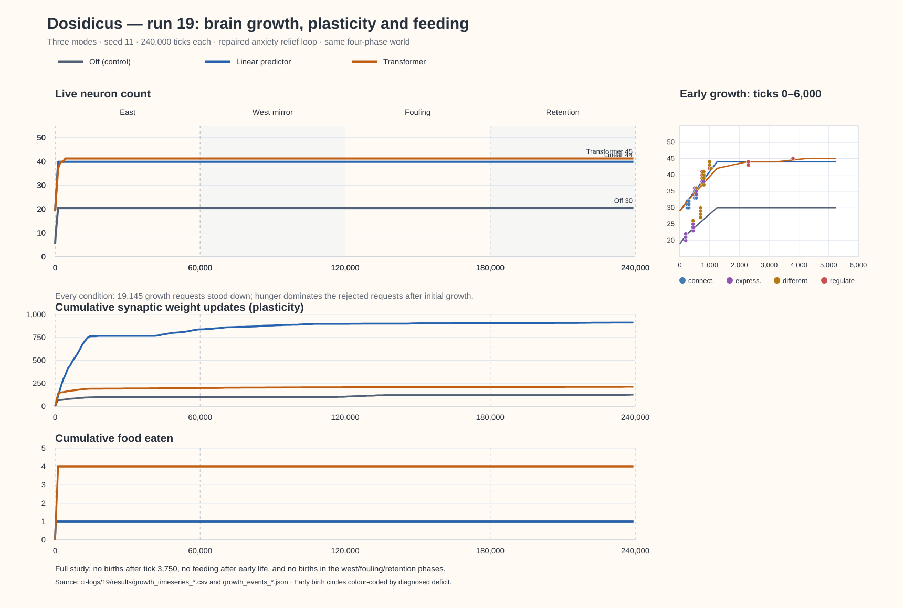

# Brain growth study: a forbidden plateau, or a satisfied one?

This branch's predictive-cognition line asked whether a small
transformer improves the squid's cognition (runs 6-9,
`docs/predictive_cognition.md`). The growth study asks a question
about the brain itself, independent of which cortex is attached:

> If the brain grows rapidly at first and then stops, **why** did it
> stop? A brain that stops growing because it is forbidden to is a
> resource limiter. A brain that stops growing because it no longer
> needs to - while it keeps learning through its existing synapses -
> is regulating its own structural growth according to its needs.

The distinction is only observable if we record the live neuron count
against simulation time **alongside everything the growth machinery
decides along the way**, in a life long enough for any early growth
spurt to have finished and been tested by new problems.

## What the engine already decides (mechanisms, from the code)

Neurogenesis v4.0 (`src/neurogenesis.py`, `src/capability.py`) is
capability-driven, not event-driven. Nothing grows because "something
happened"; structure is spent only on a diagnosed deficiency:

* The **CapabilityMonitor** diagnoses six deficit kinds from the live
  network: `representation` (a recurring situation no neuron
  distinguishes), `regulation` (a drive stuck outside its comfort band
  while corrective synapses are absent, saturated, or too weak),
  `expression` (the causal learner knows a cue-action-outcome link no
  pathway can act on), `differentiation` (one neuron forced to stand
  for two incompatible situations), `causal_differentiation` (two
  actions share credit and nothing separates them), and
  `connectivity` (an unreachable island).
* A deficit earns structure only when **persistent** (>=3
  observations, >=20 sim-seconds old), **severe** (>=0.35) and
  **unresolved** (its severity is not already falling - ordinary
  learning gets its chance first).
* **Permission to grow** is then bounded by:
  * per-type caps: stress 5, novelty 6, reward 6, connector 10 grown
    neurons;
  * a global ceiling of 100 neurons (this branch's headless config);
  * a 60 sim-second cooldown between growth actions (15s floor even
    for emergencies);
  * severity-1.0 emergencies may bypass the global ceiling, but never
    the type caps.
* **Cap reached is an answer, not a wall**: the engine deepens the
  best existing neuron of that type (strength multiplier, bounded at
  4.0x) instead of growing a duplicate, and records that it stood
  down for that reason.
* Crucially for this study, the engine keeps an **evidence trail**:
  `growth_log` (every birth, with the deficit that justified it),
  `stood_down` (every declined growth, with the engine's reason -
  cooldown, ceiling, or cap-deepening), and the monitor's `resolved`
  ledger (every deficit that closed, and why: new structure, or
  ordinary learning).

A known limitation, documented honestly: the anxiety-cap relief loop
(`update_neuron_activations`) is GUI-engine behaviour that the
headless trainer does not call, so headless stress neurons do not
mechanically damp anxiety. The growth study runs the same headless
engine as runs 6-9, so it shares this limitation.

## Run 10 design

Three conditions (off / linear / transformer, identical except the
predictive cortex, as in runs 6-9), **one seed each**, one long life of
**240,000 ticks** (10x the 24k of every previous run), in the runs-8/9
world (startle every 700 ticks, food 16 ticks later within sight,
ambient startles silenced, learning live throughout).

The world changes under the squid mid-life, so that "solving new
problems by modifying existing synapses rather than adding neurons" is
a measurement rather than an interpretation:

| phase | ticks | world |
|---|---|---|
| east | 0-60k | the runs-8/9 contingency, unchanged |
| west | 60k-120k | the same contingency mirrored: food lands 0.2 west |
| fouling | 120k-180k | east again, heavily fouled water (a genuinely new problem: cleanliness regulation) |
| retention | 180k-240k | clean water again: does the east behaviour survive? |

Telemetry, sampled every 250 ticks straight from the engine's own
bookkeeping: live neuron count, synapse count, grown tissue by type
against its cap, deepened-neuron count and total strength multiplier,
Hebbian updates, total weight-update churn, open and actionable
deficits, growth cooldown, feeding, and the drives. Births, stand-downs
and deficit resolutions are merged from the evidence trail with the
tick they occurred at. A 40-minute soft deadline per run guarantees
the study always publishes something, even if a condition runs slower
than budgeted.

Honest caveats: n=1 per condition - growth *dynamics*, not statistics;
a replication seed can follow. The growth engine is shared by all
three conditions, so any difference in growth trajectories between
conditions is attributable to what the cortex adds to the squid's
perceptual stream.

## What the verdict looks like

* **Forbidden plateau**: neuron count flat while type caps or the
  global ceiling are actually reached, and the stand-down log fills
  with ceiling/cap/cooldown reasons while actionable deficits persist.
* **Satisfied plateau**: neuron count flat with none of the bounds
  binding, no actionable deficits (or deficits closing on their own),
  while weight churn continues and behaviour keeps improving.
* **Strongest possible evidence**: a new-problem phase adapted to with
  zero new neurons - but continued synaptic churn and recovered
  behaviour.

## Results

Pending run 10; will be published from
`ci-logs/<run>/results/growth_results.json` with the live neuron-count
graph against simulation time, the capability monitor's decisions
overlaid, and the honest verdict - in either direction.

## Results: run 13 (the full 240k study, seed 11)

Run 13 (CI run on commit d2e8f412, 2026-11-09, 01:58-03:16 UTC,
published in `ci-logs/13/results/`) ran the full design above: off /
linear / transformer, seed 11, 240,000 ticks each, 4 world phases.
All three runs completed without truncation.

### The neuron curve

| | off | linear | transformer |
|---|---|---|---|
| final live neurons | 31 | 42 | 44 |
| grown neurons | 12 | 13 | 15 |
| grown by type (cap) | stress 5/5, novelty 6/6, reward 1/6, connector 0/10 | stress 5/5, novelty 2/6, reward 0/6, connector 6/10 | stress 5/5, novelty 6/6, reward 0/6, connector 4/10 |
| last birth | tick 1,000 | tick 1,000 | tick 1,500 |
| final synapses | 471 | 418 | 524 |

All growth happens in the first 1,500 ticks - inside the **east**
phase, inside the first ~6 sim-seconds of a 960-second life. From tick
1,500 to 240,000, through the west mirror, the fouling phase and the
retention phase, the live neuron count is a flat line in all three
conditions. The quick 6k-tick smoke test's early plateau was not an
artifact of a short life; the full 240k life confirms it. **The
west and fouling phases do not resume growth in any condition.**

### The monitor's decisions: verdict - a forbidden plateau

This is a **forbidden plateau**, by the criteria above:

* **Type caps bind.** The stress cap (5/5) binds in all three
  conditions; the novelty cap (6/6) binds in off and transformer. The
  global ceiling (100) is nowhere near it - 31 to 44 neurons - so the
  ceiling is not the limiter, the per-type caps are.
* **Open deficits persist.** At tick 240,000 every condition still
  carries 6-9 active, actionable deficits (anxiety:down, hunger:down,
  cleanliness:up, happiness:up, satisfaction:up, sleepiness:down, plus
  representation deficits in off and linear). Nothing about the
  plateau is "satisfied": the monitor is still asking for structure.
  The dominant one, `regulation:anxiety:down`, accounts for 19,100 of
  the 19,145 stand-downs in each condition, and its suggested type is
  stress - the cap that is full.
* **Cap-blocked births become cooldown.** The stand-down histogram's
  head is misleading: 18,825 of 19,145 stand-downs per condition cite
  "only Ns into the 60s growth cooldown", and only ~320 cite the caps
  directly ("already has 5 stress neurons; strengthened one instead").
  But the mechanism chains: when the stress cap blocks a birth the
  engine *strengthens* an existing stress neuron, and that growth
  action restarts the 60s cooldown - so every subsequent evaluation of
  the still-open anxiety deficit is declined for "cooldown". The
  cooldown citations are the caps' shadow, not an independent reason.
  The capability monitor wanted a sixth stress neuron for 239,000
  consecutive ticks and was structurally refused.

The mode differences are real but secondary: the transformer brain
grows more (15 vs 12/13) and - uniquely - keeps **weight churn** alive
after the last birth (91 Hebbian updates after tick 1,500, cumulative
updates rising 105 -> 196 across the west/fouling/retention phases;
off and linear are frozen at 106 and 78). Even so, the transformer
squid's food eaten does not rise after tick 2,250 (3 total, all in
east), and it never eats in west, fouling or retention.

### Behavioural failures, documented honestly

* **Feeding collapses after the east phase.** Food eaten per phase:
  off 0/0/0/0 (1 total, tick <1,000), linear 0/0/0/0 (1 total),
  transformer 2/0/0/0 (3 total). No squid eats a single meal in the
  west, fouling or retention phases - 180,000 ticks of starving next
  to food.
* **The drives never recover.** Mean anxiety and hunger sit at ~100
  and cleanliness at ~0 for the last three phases in all conditions;
  the off-mode squid spends 239,632 of 240,000 actions "exhausted".
  The growth machinery's whole premise - diagnose a deficiency and
  fix it - is visibly failing to fix anything here.
* **The fouling problem was never solved.** The cleanliness deficit
  (a genuinely new problem at tick 120k) stood down 20 times in each
  condition and produced zero births (the transformer's
  `filth_avoidance` neuron was born at tick 1,000, in east, before
  fouling began) and no behavioural adaptation.
* The known headless-engine limitation above (stress neurons don't
  mechanically damp anxiety in the headless trainer) explains *why*
  the anxiety deficit never closes - which is why the stress cap
  stays pinned. The plateau is forbidden, and the forbidding cap is
  full of neurons that cannot do their job in this engine.

### What run 13 settles

Growth does not stop because the brain is satisfied. It stops because
two type caps fill up in the first six sim-seconds while the monitor's
top deficit permanently requests exactly the capped type. The 6k
smoke test's "12-15 grown neurons, caps far from binding, churn
continues" picture did not survive the full run: caps **are** binding
(stress 5/5 everywhere, novelty 6/6 in off/transformer), churn
continues only in the transformer condition, and no new phase - west
mirror or fouling - resumes either. Next steps worth considering:
raise or remove the stress cap, or fix the headless anxiety-relief
loop, and re-run to see whether growth resumes when the deficit's
requested type is available again.

## The anxiety relief loop, fixed (post-run-13 follow-up)

Run 13's verdict was a forbidden plateau whose root cause is documented
above as a known limitation: the engine's suppression feedback
(`EnhancedNeurogenesis.update_neuron_activations`) is GUI-engine
behaviour the headless trainer never called. The suppression neurons
grew (to the cap, 5/5) but never forced anxiety down, so anxiety pinned
at 100, the anxiety regulation deficit could never close, and the
monitor demanded a sixth stress neuron for 239,000 consecutive ticks
while the cap refused - the 18,825 "cooldown" stand-downs per condition
were the shadow of that refusal.

The fix: the headless simulation now presents itself as the brain's body
handle (`brain.tamagotchi_logic = self`, the same attribute the engine
already reads defensively) and runs the engine's own relief loop every
tick, after the action and before the next observation, so:

* every grown stress neuron is driven on anxiety
  (`50 + (anxiety - 50) * 1.2`) and subtracts from it, scaled by its
  strength multiplier;
* anxiety is clamped to the suppression cap (`100 - 10 * stress_count`,
  floored at 50) on the body as well as the network state;
* the birth-time relief of 15 points reaches the body too.

With the full five stress neurons the cap permits, anxiety can never
exceed 50 - inside the 0-60 comfort band - so the anxiety regulation
deficit (19,100 of 19,145 stand-downs in every run-13 condition) should
finally close and the stress cap should stop being the binding
constraint. Whether growth then resumes for the remaining deficits
(hunger, cleanliness, the representation deficits) is exactly what a
re-run of the study will measure; four regression tests in
`tests/test_headless_training.py` (StressSuppressionTests) pin the
mechanism itself.

Honest caveats:

* Run 13's numbers stand for the code as it was run. Nothing above has
  been re-measured yet; the re-run decides whether the plateau dissolves.
* Two side effects of giving the brain a body handle, both toward how
  the game already behaves: growth's personality-keyed wiring table now
  reads the headless squid's seeded personality (it used to fall back to
  `adventurous`), and the birth-time long-term-memory recording is
  still skipped (the headless squid has no `memory_manager`).
* The relief is identical in all three conditions - off, linear and
  transformer - so the study's comparisons remain fair.
* The stress type cap itself is unchanged (5). The fix makes the five
  permitted neurons do their job; it does not permit a sixth.

### Post-run-17 correction: two real bugs in the first fix

CI run 17 (repair commit 9060d37a) was honest about the first fix and
found it wanting: 52 of 55 baseline tests passed, but the two new
suppression tests failed and the seeded-reproducibility test broke.
Both failures were real bugs, and the reproducibility break was two.

1. The repair commit duplicated the trainer's constructor
   (`HeadlessBrain` and `HeadlessSquid` were each built twice), and
   the squid draws its personality from the seeded random stream - so
   the extra draw shifted every subsequent random number and the two
   seeded runs in the reproducibility test diverged.
2. The engine's relief loop had a deadlock all along, which is why the
   new suppression tests failed: `update_neuron_activations` clamps
   anxiety to the suppression cap *before* computing the stress
   neurons' driven activation. With the cap at 50 the driven value is
   exactly 50, never crosses the 55 activation threshold, no reduction
   is ever computed - and the squid's body, which is only written
   inside that reduction branch, is never relieved. The brain's state
   was clamped every tick while the body sat at 95+, forever.
3. The relief loop stamps grown neurons' `last_activated` with the
   wall clock, and that timestamp is part of a brain's export - so two
   identical seeded runs exported different brains even with the
   constructor fixed.

The follow-up commit fixes all three: the duplicated constructor is
removed; the relief loop drives the neurons from the anxiety the squid
actually feels (pre-cap) and clamps the body to the cap even on ticks
when no neuron is hot; and the activation stamp reads the deterministic
simulation clock the engine is already given (falling back to wall time
only where no clock was supplied, i.e. the GUI, whose behaviour is
unchanged). Run 13's verdict stands for the code that ran it; whether
the plateau dissolves is for the re-run.

### The corrupted first attempt (commit 6501e917; CI run 16 is invalid)

The first attempt at this fix (6501e917) shipped a corrupted
`headless_trainer.py`: the file had been fetched through a raw
web-page reader that silently mangles files larger than ~32 KB
(mid-word line breaks, truncation), and the damage passed unnoticed
into the commit. CI run 16 failed with a SyntaxError at line 175, and
its publish step (`if: always()`) nonetheless committed a
`ci-logs/16/` results directory - those results are stale leftovers
from the working tree, not a measurement of anything, and are hereby
declared **invalid**. The repair commit 9060d37a rebuilt all three
files from clean sources at pre-fix commit f580e2f8 and passed
syntax; its own remaining bugs are documented above. Process lesson,
recorded for the future: repository files are always fetched through
the GitHub file API, never through a web page reader.

### Run 18: the fix validated (6k-tick smoke, seed 11)

CI run 18 (commit fec24337) is the first fully green run of the
repaired relief loop: **55/55 baseline tests pass** - including the
four StressSuppressionTests and the restored seeded-reproducibility
test - and the 6k-tick growth smoke (`ci-logs/18/results/`) shows the
loop working in vivo:

| | off | linear | transformer |
|---|---|---|---|
| final neurons (grown) | 30 (11) | 44 (15) | 45 (16) |
| stress neurons (cap 5) | 5/5 | 5/5 | 5/5 |
| mean anxiety, east phase | 0.0 | 7.1 | 5.0 |
| mean anxiety, west/fouling/retention | 0.0 | 0.0 | 0.0 |
| last birth | tick 700 | tick 1,000 | tick 3,700 |
| births in west / fouling | 0 / 0 | 0 / 0 | 2 / 1 |
| deficit resolutions | 28 | 44 | 101 |
| food eaten (east phase / total) | 0 / 1 | 0 / 1 | 3 / 4 |

Run 13 for comparison: mean anxiety ~100 in every condition for the
whole life; no birth after tick 1,500 in any condition; no meal after
tick 2,250 in any condition; and the anxiety regulation deficit
accounted for 19,100 of 19,145 stand-downs per condition. In run 18
that deficit is **absent from the monitor's active list in all three
conditions**.

Honest reading:

* The relief works as designed: anxiety collapses under the
  suppression cap everywhere. It collapses perhaps *too* completely -
  to 0, not just under 50 - so whether the stress pathway still earns
  its keep, and whether an all-zero anxiety starves the anxiety-driven
  plasticity of signal, is a question the full re-run's evidence
  trail will answer.
* The binding deficit is now **hunger**, not anxiety: all three
  conditions still end with hunger, cleanliness, sleepiness and
  satisfaction stuck outside their comfort bands and the stress cap
  full of filth/hunger-response neurons. A plateau verdict may well
  return, but for a different reason than run 13's.
* The transformer condition is again the only one that resumes growth
  after the east phase (births in west and fouling, including
  `filth_avoidance` and `squalor_alarm` grown *during* the fouling
  phase - run 13's fouling problem produced zero births in any
  condition) and again the only one that eats more than once. Its
  101 resolutions versus 28/44 also suggest the monitor is closing
  deficits, not just demanding structure.

### The full re-run (launched with the working relief loop)

The full 240k-tick study - same design as run 13: off / linear /
transformer, seed 11, four world phases, live neuron telemetry against
the capability monitor's decisions - is relaunched on the fixed
engine. Its verdict, whether the forbidden plateau dissolves and for
which deficits, will be recorded here from
`ci-logs/<run>/results/growth_results.json` when CI publishes it.

## Results: run 19 (full 240k re-run with the corrected relief loop)

Run 19, from `7071cdd2` (9 November 2026; CI run 19, published
as `8d28329d`), completed **240,000 ticks in all three conditions**
with the fixed headless anxiety-relief mechanism. CI was green:
36 predictive-cognition tests and 55 baseline headless tests
(plus 114 subtests). It is an n=1 **mechanism study**, not a
population-level demonstration of improved cognition.

Raw reproducible inputs for the chart: `ci-logs/19/results/growth_summary.json`,
`growth_events_{off,linear,transformer}.json`, and
`growth_timeseries_{off,linear,transformer}.csv`.

| Metric | Off | Linear | Transformer |
|---|---:|---:|---:|
| Final neurons (grown) | 30 (11) | 44 (15) | 45 (16) |
| Last birth (tick) | 750 | 1,000 | 3,750 |
| Final synapses | 378 | 514 | 593 |
| Weight updates (total) | 127 | 912 | 213 |
| Weight updates after last birth | 64 | 800 | 55 |
| Capability-deficit resolutions | 172 | 432 | 381 |
| Total food eaten (whole life) | 1 | 1 | 4 |
| Food eaten after last birth | 0 | 0 | 0 |
| Growth requests stood down | 19,145 | 19,145 | 19,145 |

### What changed from run 13, and what did not

**Anxiety suppression now works**: mean anxiety in the later three
world phases is 0.0 in all modes, versus ~100 in run 13. The
`regulation:anxiety:down` deficit no longer appears among the final
actionable deficits. The original run-13 diagnosis—stress neurons
were unable to suppress anxiety in headless simulation—was real and
the specific bug has been repaired.

**The forbidden plateau remains**, for a new binding problem.
Every condition again fills the **stress type cap (5/5)**, though the
100-neuron global ceiling is not close to binding. Hunger and
cleanliness regulation remain actionable in all conditions; hunger
is at 100 and cleanliness at 0 over the final three phases. The
growth-engine stand-down ledger now overwhelmingly names
`regulation:hunger:down`: 19,140 of 19,145 in off, 19,120 in
linear, and 18,920 in transformer. Approximately 316–320 per
condition are explicit five-stress-neuron cap/deepening refusals;
most of the rest cite the cooldown repeatedly reset by those
deepening actions. The earlier finding "stress type cap + recurring
cooldown blocks requests" is therefore **confirmed with a
different unmet need**. Merely fixing anxiety did not cure the
structural growth bottleneck.

**The brief run-18 growth after the east phase does not extend to
full life**: run 18 used four compressed 1,500-tick phases inside
6,000 total ticks, so the transformer's births at 2,250 and 3,750
fell in its miniature fouling phase. In the full-length run 19 the
four phases are each **60,000** ticks; all 16 transformer births
therefore happen in *east*, and there are zero new neurons in the
west, fouling, or retention phase in all three modes. Run 18 did
not establish long-term challenge-induced growth.

### A stronger and more concerning result: action collapse

The resulting organism behaviour is not a successful example of
"fixed brain size, improving behaviour":

* **No feeding after early life.** Total meals were 1/1/4; the
  transformer ate its fourth meal before its last birth at tick
  3,750. No condition ate in the last three phases. The phase
  summariser subtracts the first sample of each phase, so its
  east-phase `food_eaten` figures *omit* meals consumed before
  tick 250; the `food_eaten_total` and action counters are the
  authoritative lifetime totals.
* **Motor behaviour differs dramatically.** Final
  `actions_selected` reports 239,477 **idle** decisions for
  transformer, 48,122 for linear, and 41,211 for off, out of
  240,000 ticks each. Transformer selected `exploring` only
  510 times, compared with 191,875 linear and 198,785 off.
  Transformer selected `eating` 13 times in its entire lifetime.
  The animal largely stops acting rather than simply failing to
  solve the altered world.
* **Weight updates continue without functional adaptation.**
  Off, linear and transformer accumulated 64/800/55 weight
  updates after their last birth, but no new meals. Counting
  Hebbian updates or "resolved" deficit events as successful
  behavioural learning would be misleading: 381 transformer
  deficit-resolution events did not produce functional recovery.
* **Anxiety may now be over-suppressed**: it sits at zero despite
  chronic hunger, severe uncleanliness and repeated startles.
  The suppressor made anxiety numerically comfortable but may
  have eliminated a useful drive signal. This is an open
  hypothesis, not a conclusion from the present data.

### Next falsifiable experiment: diagnose the action bottleneck first

Before lifting the stress type cap or changing learning/plasticity
rules, **instrument an unchanged simulation** at high temporal
resolution and determine *why* each mode stops choosing its
actions. Log each motor neuron's actual activation against its
selection threshold, food visibly available, hunger and
sleepiness, whether the squid is sleeping, and the per-window
counts for eating / exploring / idle / exhausted / sleeping.
Keep the three cortex conditions, seed 11, identical schedules,
and no automatic feeding. The diagnostic must not modify
squid behaviour or random-number consumption.

A follow-up controlled rescue can then distinguish a dead
motor pathway from irreversible internal drive saturation:
intervene in one drive (e.g. restore sleepiness or cleanliness
briefly), explicitly mark those interventions as artificial
and **never** count them as earned feeding or learning. Only
after an identifiable cause is demonstrated should we vary
the stress cap, suppression strength, or action policy.

## Results: run 20 (read-only motor and food-visibility diagnostic)

Run 20, experiment commit `379991eb`, CI
`42652663624` (9 November 2026), passed both test stages and
completed a 6,000-tick, seed-11 quick growth experiment with
read-only motor/action/food telemetry. Results are in
`ci-logs/20/results/growth_timeseries_{off,linear,transformer}.csv`.
The only code change was additional observation at regular sample
ticks; no actions, learning rules, random draws or neural parameters
were changed.

**Motor pathway diagnosis:**

* Transformer `act_move` is 51.98 at tick 100, 47.41 at tick
  500 and **0 at tick 900**, remaining 0 at every subsequent
  sampled tick through 5,700. Its threshold is 45 and resting
  level 50. Exactly 510 of 6,000 ticks choose exploration;
  5,477 choose idle; none choose exhaustion.
* Off and linear locomotion stay around 49–60 across the same
  samples and choose exploration 5,996/5,997 times, respectively.
* Transformer **can see food** at the tick-900 sample and
  throughout later sampled ticks; `food_seen_ticks` reaches
  5,209 by tick 5,700 and 105 food objects remain in the tank.
  The squid is not idle because food is absent or invisible.
* At later samples, `act_eat` is exactly **0 in all three
  modes**, including samples with visible food. The direct
  food-to-eating instinct (threshold 38) is therefore not
  producing a usable motor command. All three conditions stop
  eating after their first few hundred ticks. This is a shared
  feeding-pathway problem, separate from the transformer's
  complete locomotion shutdown.
* The quick run reproduces the full run's lifetime trend:
  off/linear/transformer ate 1/1/4 meals, with final neurons
  30/44/45. This adds an explanation for the early collapse,
  but **not yet a causal account of why the synaptic input
  to either motor neuron is suppressed**.

**Next diagnostic**: record the *actual weights* of the innate
`can_see_food → act_eat`, `hunger → act_eat` and
`curiosity → act_move` paths, alongside each motor neuron's
largest positive and negative synaptic contributors. The
remaining alternatives are learned negative wiring, active
inhibition, or an unexpected read/propagation path.
The diagnostic must remain read-only and use the same seed and
cortex conditions. Only after identifying the mechanism should
we change the motor network or plasticity.

## Results: run 21 (synaptic provenance of behavioural collapse)

Run 21 (commit `db7f7e32`, published `a21b75a3`; workflow
`42653677042`) passed its tests and completed the same 6k-tick
three-mode seed-11 quick study. Its additional read-only
`motor_synaptic_inputs` probes record signed incoming contributions
to `act_eat` and `act_move`, together with the weights of three
innate motor pathways. The telemetry uses **post-step source
activation**, not a replay of the exact pre-propagation snapshot;
these are diagnostic approximate sums, not exact predicted motor
activations.

At tick 900 (food visible in all modes):

| Input | Off | Linear | Transformer |
|---|---:|---:|---:|
| `act_eat` positive contribution | +63.20 | +78.39 | +52.62 |
| `act_eat` negative contribution | -337.04 | -348.29 | -228.93 |
| `act_eat` motor activation | 0 | 0 | 0 |
| `can_see_food -> act_eat` weight | +0.9098 | +0.9097 | +1.0000 |
| `act_move` positive contribution | 0 | +0.92 | 0 |
| `act_move` negative contribution | -0.10 | 0 | -70.23 |
| `act_move` activation | 49.92 | 50.94 | **0** |
| `curiosity -> act_move` weight | +0.45 | +0.45 | +0.45 |

The food-to-eat synapse **survives and is positive** in all three
conditions, yet many large negative inputs overwhelm it. The most
negative `act_eat` inputs in off come from newly grown
`tension_release`, `role_separation`, and `second_opinion`
neurons at approximately -0.8 apiece; linear receives -0.8
from `relay_bridge`, `waypoint`, and `learned_expectation`;
transformer receives -0.8 from `play_reward`,
`investigation_drive` and `curiosity_spark`.

In transformer the motor shutdown has an additional structural
source: `novelty_role_separation_2 -> act_move` contributes -31.32,
`novelty_role_separation -> act_move` contributes -16.68,
and **`can_see_food -> act_move` contributes -15.60** (weight -0.3121).
Further stress-neuron inhibitory motor inputs appear later. In off
and linear, `act_move` remains near its innate resting level (50).

### The likely construction defect, located in source code

`FunctionalNeuron.get_functional_connections`
(`src/neurogenesis.py`) loops over **all**
`creation_context.active_neurons`. When any neuron's value deviates
from 50 by more than 20, it creates an output from the newborn to
that neuron, signed by its deviation:
`weight = +/- abs(value-50)/50*0.8`. The context includes action
neurons as well as sensory/stat neurons. Consequently, a motor
neuron at 0 during birth receives an **incidental newborn -> motor
weight of -0.8**, even if that newborn is needed for an entirely
different deficit. The creation path merges this ambient-context
wiring with its *intentional* deficit-remedy wiring, then records the
edges as neurogenesis. This mechanism accounts for the cluster of
-0.8 weights actually observed and explains how early growth
could suppress later actions; it is stronger evidence than a
mere correlation, but a controlled ablation must establish how much
of the behavioural collapse it causes.

**Falsifiable next experiment:** compare unmodified neurogenesis with
a version that excludes motor neurons only from the *incidental*
birth-context output list, keeping the explicitly planned
deficit-remedy and innate motor synapses untouched. Use matched
seed-11 quick runs in all three cortex modes; measure earned
feeding, locomotion, motor activations and new-neuron counts,
and do not infer a population effect from one seed. If deleting
these unwanted edges does not restore feeding, investigate
intentional differentiation-remedy offloads and other inhibitory
motor connections. Do not replace the squid's decisions with
a hand-authored behaviour rule.

## Results: run 22 — causal test of accidental newborn-to-motor inhibition

**Status: successful GitHub Actions run 22**, launched by commit
`12cdb21e` (9 November 2026; [workflow](https://github.com/ViciousSquid/Dosidicus/actions/runs/42655419535)).
All 38 predictive-cognition tests, 55 baseline tests and 114 subtests passed.
The raw result is at `ci-logs/22/results/motor_wiring_study.json`.

The experimental intervention is *opt-in* (headless
`TrainingConfig.context_motor_autowiring=False`), leaving the default
engine and all other branches unchanged. It removes **only the incidental
birth-context outputs from newly grown neurons into motor targets**
(`act_*`). It preserves innate wiring, explicit deficit-remedy synapses,
existing plasticity and decision selection, and introduces no artificial
meals or motor commands. Each arm runs the actual brain for 6,000 ticks
under the same seed (11), with identical environmental scheduling.
`historical` is the control.

| Mode | Control earned meals | Without incidental motor wiring | Control exploring / idle | Intervention exploring / idle |
|---|---:|---:|---:|---:|
| Off | 1 | **132** | 5,996 / 0 | 1,482 / 4,152 |
| Linear | 1 | **46** | 5,997 / 0 | 724 / 5,132 |
| Transformer | 4 | **4** | 510 / 5,477 | 4,559 / 1,365 |

The control had **11/15/12 negative newborn-source synapses into
`act_eat`** (off/linear/transformer), summing to
-8.7574/-11.9965/-9.6, and the transformer also had five negative
newborn-source connections into `act_move`, summing to -3.36.
With the intervention all three have **zero** negative newborn-source
synapses into either motor. Nevertheless, the transformer condition
still eats four meals only.

**Interpretation:** The birth-context auto-wiring of inactive motor
neurons causes catastrophic inhibitory interference: a motor neuron
at 0 attracts an arbitrary -0.8 output from each newborn, regardless
of the newborn's diagnosed purpose. Its removal **causally rescues
feeding in the off and linear controls** and restores sustained
locomotion in the transformer. A crucial limit is that it **does not
rescue transformer feeding** in this seed, so it is not a sufficient
fix for the entire research programme. A larger sample is required
before reporting population benefits.

The intervention also changes the subsequent developmental history;
final counts are 31/46/44 neurons versus 30/44/45 in the controls.
The effect is not merely adding back a fixed set of meals. The
off-mode food-visible tick count falls sharply (5,595 to 551)
because food is being eaten and the organism behaves differently;
it cannot by itself be interpreted as worse perception.

### Remaining unexplained transformer-specific deficit

Run 21 showed that the transformer's `hunger -> act_eat` innate
weight dropped to **0 by tick 500**, unlike off/linear in that run.
One possible cause is the differentiation remedy's
`_retire_edge((offload, target))`, which hands an existing edge
to a newborn without distinguishing an innate instinct from a
learned synapse. This is **not yet established as the cause**:
plasticity, pruning or a different pathway can also remove an
edge. It requires event-level provenance from the causal ledger.

Next: instrument read-only *per-edge provenance* and test
independent seeds with the same opt-in ablation. If the survival
rescue replicates, investigate a separate controlled hypothesis
for the transformer's remaining feeding deficit. Do not silently
change the baseline, force eating, or erase squid 222.

## Results: run 24 — provenance proves a second, distinct motor-pathway disruption

Run 24 (commit `1d190d61`, successful workflow
[42656891829](https://github.com/ViciousSquid/Dosidicus/actions/runs/42656891829))
re-ran the paired 6,000-tick seed-11 study from run 22 with
**read-only** per-edge provenance from the existing
`CausalLedger`. The outcomes repeated exactly: off
1→132 meals, linear 1→46, and transformer 4→4;
transformer exploration 510→4,559 ticks.
The measurements are in `ci-logs/24/results/motor_wiring_study.json`.

The lifetime ledger resolves the open run-21 question:

| Condition | Fate of innate `hunger → act_eat` |
|---|---|
| Off, historical | Survives; final weight ≈+0.3553 |
| Off, no incidental motor wiring | **Removed by neurogenesis**; handed over to `role_separation`; nevertheless eats 132 meals |
| Linear, historical | Survives; final weight ≈+0.4007 |
| Linear, no incidental motor wiring | Survives, strengthened to ≈+0.7499; eats 46 |
| Transformer, historical | **Removed by neurogenesis**; handed over to `role_separation`; eats 4 |
| Transformer, no incidental motor wiring | **Removed by neurogenesis**; handed over to `second_opinion`; eats 4 |

These are **explicit ledger events**, not assumptions inferred from
a missing weight. In the transformer intervention the old weight
was **+0.3994**, then removed by
`mechanism: neurogenesis`,
`note: handed over to second_opinion`.
The differentiation remedy in `src/neurogenesis.py` calls
`_retire_edge((offload, target))` after wiring the new neuron.
The original drive-to-motor path is literally deleted.

At tick 6,000 the transformer intervention's
`second_opinion → act_eat` link retains a positive weight
of about +0.3994, but because the *source* is below its
resting level, it contributes approximately **−19.97**
inhibitory units to the eating neuron. The direct
`can_see_food → act_eat` pathway remains near +1 and
contributes approximately +50 when food is visible;
other negative contributors also exist. Observed
`act_eat ≈32.18` at tick 6,000 is below its firing
threshold 38.

**Crucial distinction:** this innate-hunger offload is **not
unique to transformer**: the off intervention also retires
`hunger → act_eat` yet feeds successfully. Offloading is
therefore a verified secondary structural alteration, but
**not by itself a demonstrated unique cause** of
transformer feeding failure. A bad *replacement* signal or
its interactions with predictive inputs may matter.

### Follow-up: Run 25, controlled innate-route preservation

Commit `8cca376a` starts a new **opt-in** paired intervention:
both arms first block the incidental newborn-to-motor
edges from run 22. In one arm, differentiation transfers
still create the normal remedy connection but no longer
delete an existing **innate direct motor synapse**.
The control arm retains the historical offload. No action,
feeding policy, innate weight, motor threshold or food
count is directly forced; default production behaviour
is unchanged (`preserve_innate_motor_offload=False`).

The test is falsifiable: if transformer feeding increases
from four meals when the direct hunger connection survives,
then the loss of the innate pathway contributes causally to
its residual deficit. An increase in both arms or no
increase would require a different interpretation.
The first test remains **n=1**, so any positive result
will still require independent-seed confirmation.
