# CANARY: actual app recordings

Open this page on GitHub in a browser. The animations below are ordinary GIF files; no chat thumbnails or special viewer is needed. If GitHub pauses an animation, open its direct link.

## Fighting: one cloud over both squid

Two separate desktop processes discover each other over the real multiplayer protocol. Indigo visits Coral's tank. They move close together and one animated cartoon cloud covers the pair. The cloud is about 20% smaller than the original demo.

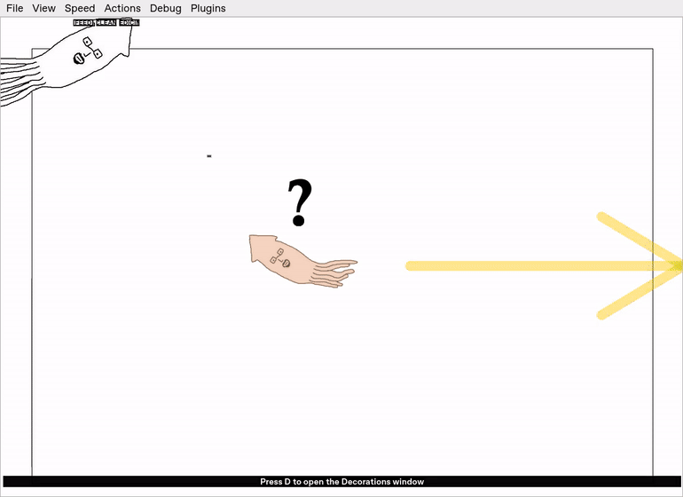

[Open fighting GIF](fighting.gif?raw=true)

## Breeding, egg, parental death and a fresh game

Mating lays an egg. The parent refuses food, starves and dies. The egg then cracks, the simulation resets behind its animation, “Hatching!” appears, and a newborn starts a fresh game with a new identity and brain.

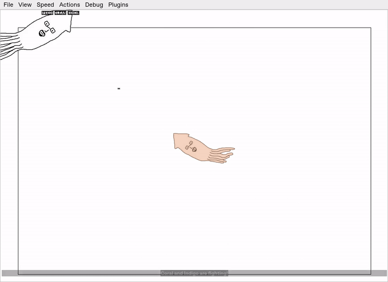

[Open egg and new-game GIF](egg-new-game.gif?raw=true) · [Watch both instances together](two-instances.mp4?raw=true) · [Download a standalone gallery](gallery.html?raw=true)

These are controlled demonstrations of the real application, recorded with `tools/capture_multiplayer.py`. The demo triggers a contest, makes the host's mating roll certain and accelerates the final starvation tick. Normal gameplay keeps the 2% mating chance after five seconds of sustained contact, once per visit. The network exchange, egg creation, death, reset and hatching run through the production code.

## The lifecycle, frame by frame

| Egg laid | Parent has died |
| --- | --- |
| 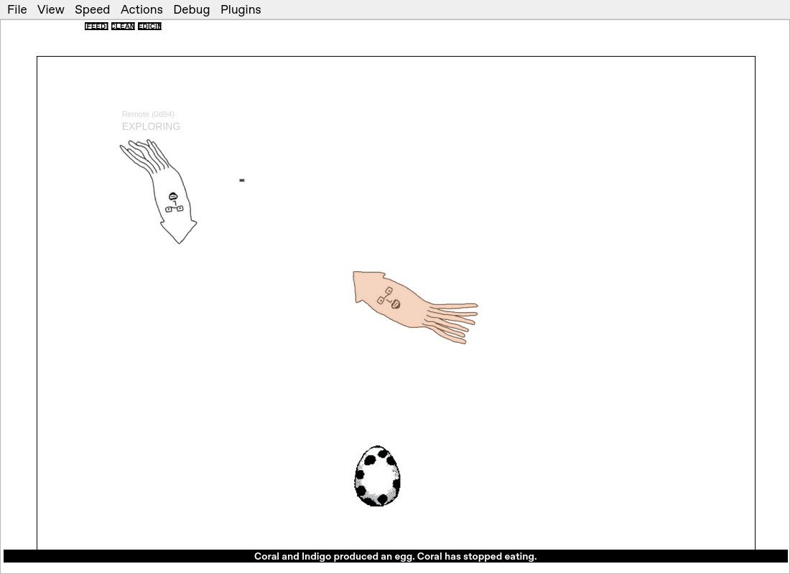 | 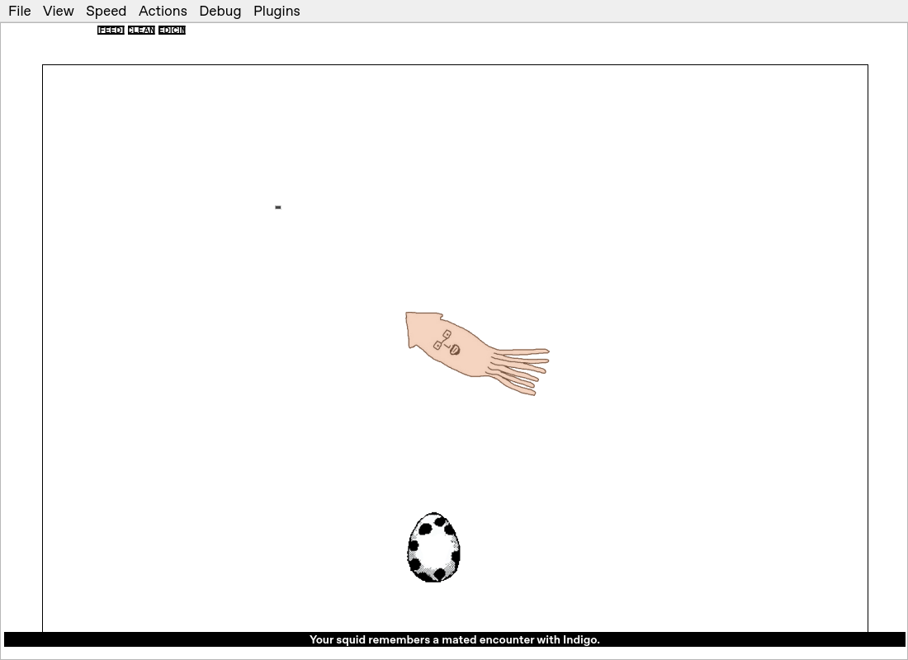 |
| Hatching | Newborn in a fresh game |
| 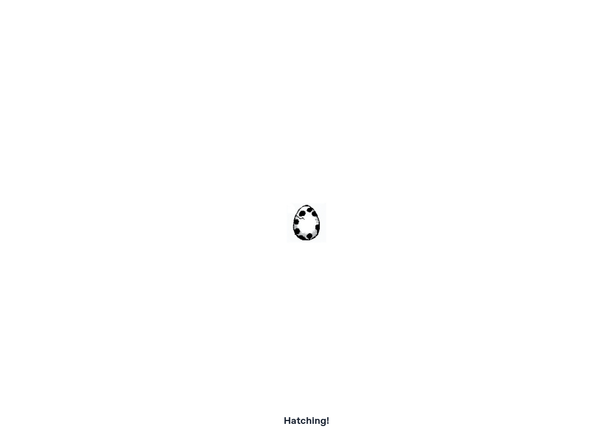 | 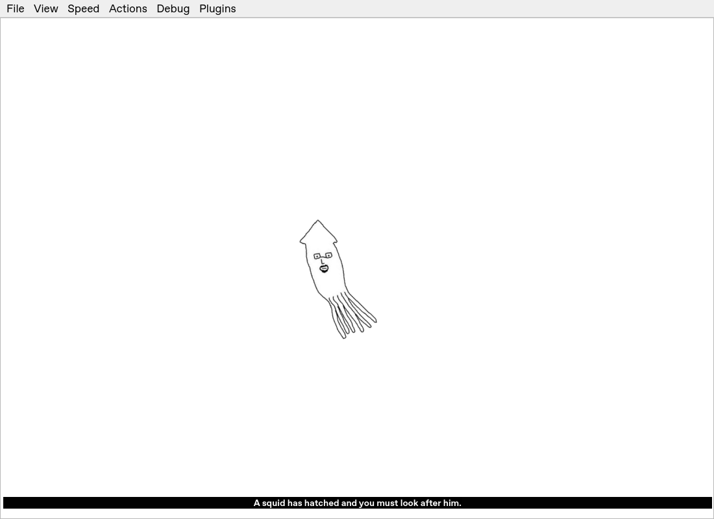 |

The recording checks that the cover immediately before and after the actual reset is pixel-identical, the squid UUID changes, and there is exactly one fighting cloud. [Recorded verification](verification.json).

## First-encounter concept and fight statistics

A squid that never encounters another never grows this concept. The first actual
sighting grows one novelty-class neuron named **Social** or **Encounter**. Later
encounters reuse it. Its birth provenance says **“Other squid encountered!”**,
records the visible-peer evidence, and lists its initial positive connection to
Anxiety. Learning can change that connection. The name, wiring and provenance
survive desktop/mobile/Designer/trainer transfers.

In this recording the host grew **Encounter** and the visitor grew **Encounter**:
[host provenance](host-social-provenance.json) · [visitor provenance](guest-social-provenance.json).

**Timid squids never initiate fights.** They can be attacked by another squid.
The host resolves each completed fight once and sends the result to the visitor;
repeated result packets do not increase the counters again. **Fights won** and
**Fights lost** appear on the Brain Tool's Statistics tab and persist in saves.

| Host Statistics | Visitor Statistics |
| --- | --- |
| 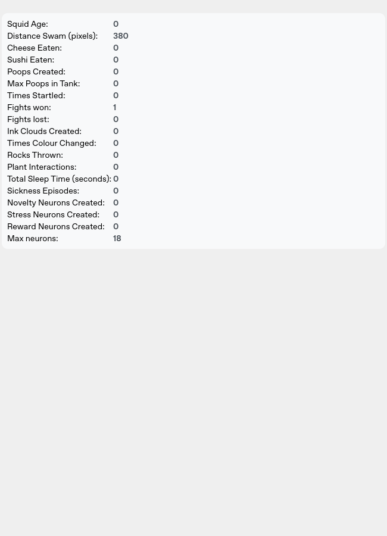 |  |

## Mobile design

Real Kivy screens at phone resolution. The Android release is [available here](../../android/releases/README.md).

| Named, tinted squid | Name and colour controls |
| --- | --- |
| 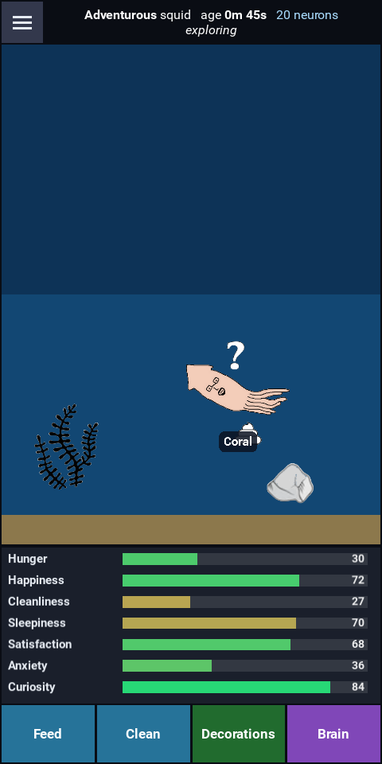 | 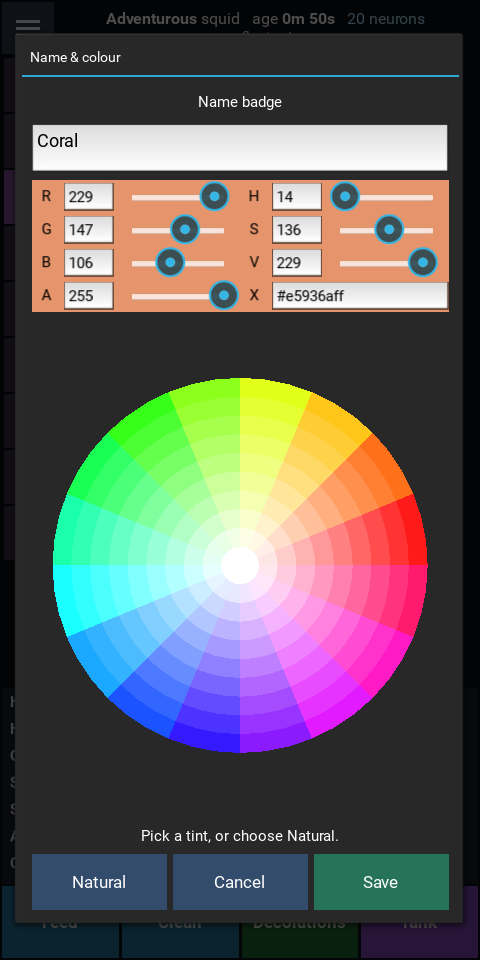 |
| Neural network | Brain Designer |
| 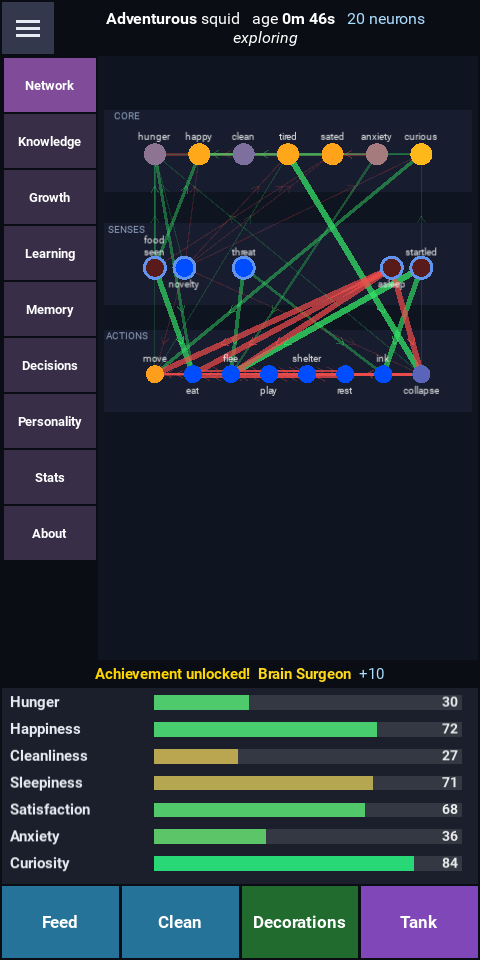 | 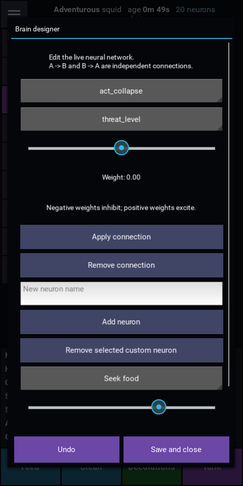 |
| Learning | Decisions |
| 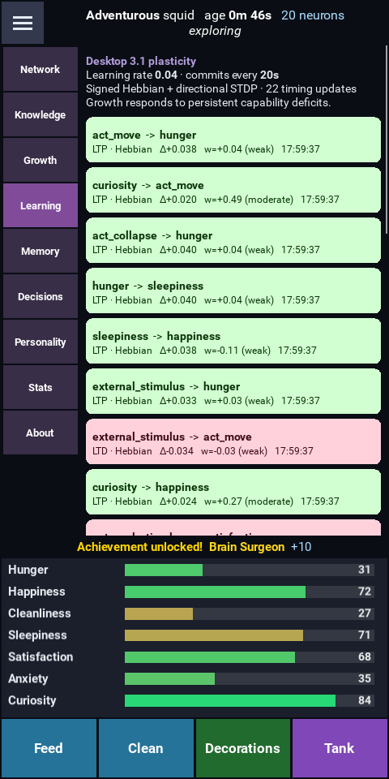 | 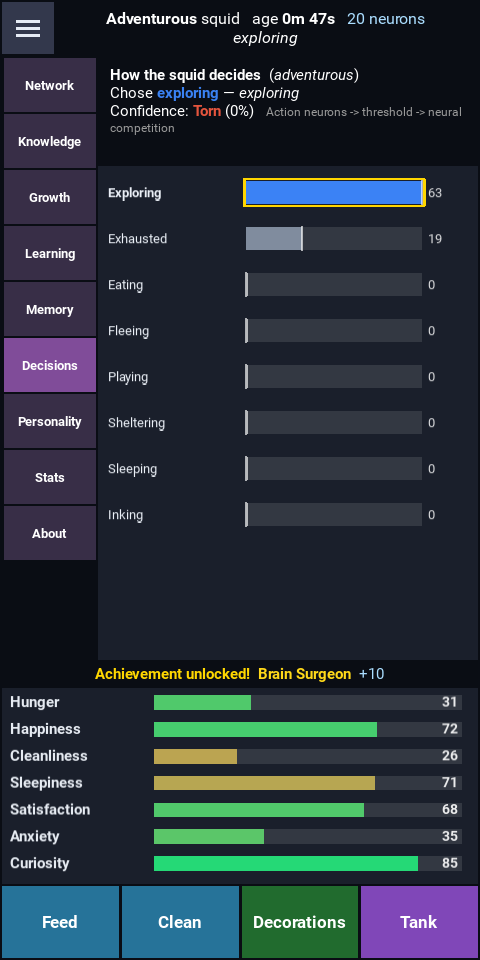 |
| Knowledge | Growth |
| 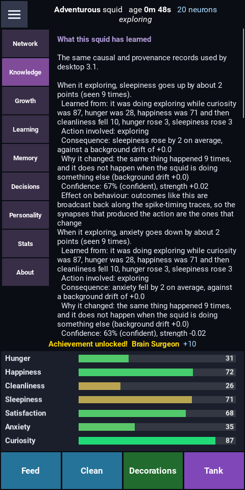 | 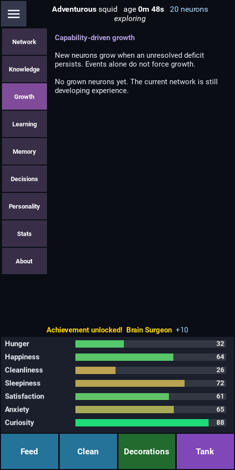 |

The multiplayer lifecycle recordings above are desktop recordings. The Android build uses the shared desktop neural core and interchange formats; its native nearby-player interface remains separate from the desktop multiplayer protocol. Physical Android installation has not been tested in this environment.
