# 4 squid, 4 homes, 12 minutes

3 copies of the desktop game and 1 of the Android game on a phone, each in a home of its own behind its own router, found each other with friend codes and were then left alone for 12 minutes. Nothing told any squid what to do. Every address, code, thought and number here is from the run.

**The full page, with every picture and the whole session line by line, is [index.html](index.html)** (open it in a browser).

| Squid | Personality | Colour | Home address | Seen from outside as | Friend code |
|---|---|---|---|---|---|
| Ziggy | adventurous | as it hatched | `192.168.1.2:10000` | `100.64.1.2:10000` | `K4800-G49RG-0QZ8K` |
| Inky | timid | rgb(120,170,255) | `192.168.1.2:10000` | `100.64.2.2:10000` | `K4801-049RG-MYRTQ` |
| Pesto | greedy | rgb(255,105,180) | `192.168.1.2:10000` | `100.64.3.2:10000` | `K4801-G49RG-99QP6` |
| Bolt | energetic | rgb(120,220,140) | `192.168.1.2:10000` | `100.64.4.2:10000` | `K4802-049RG-WEFH2` |

## Apart, then linked

Before any code was entered the tanks had heard 0 other tanks between them. Everyone entered everyone else’s code; the last of the 12 links through the routers came up 5 s later.

| 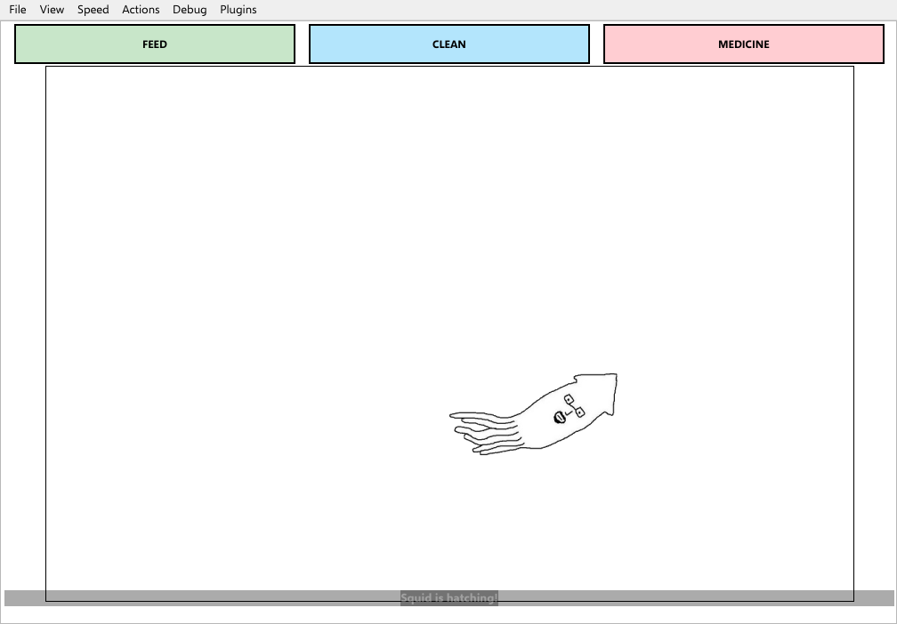 | 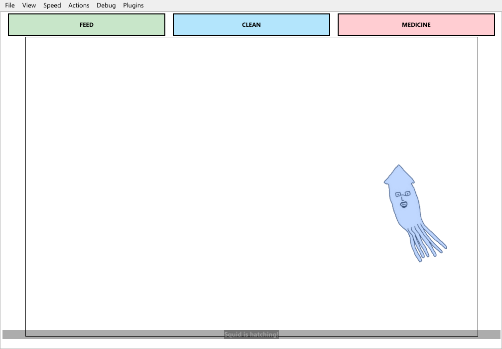 | 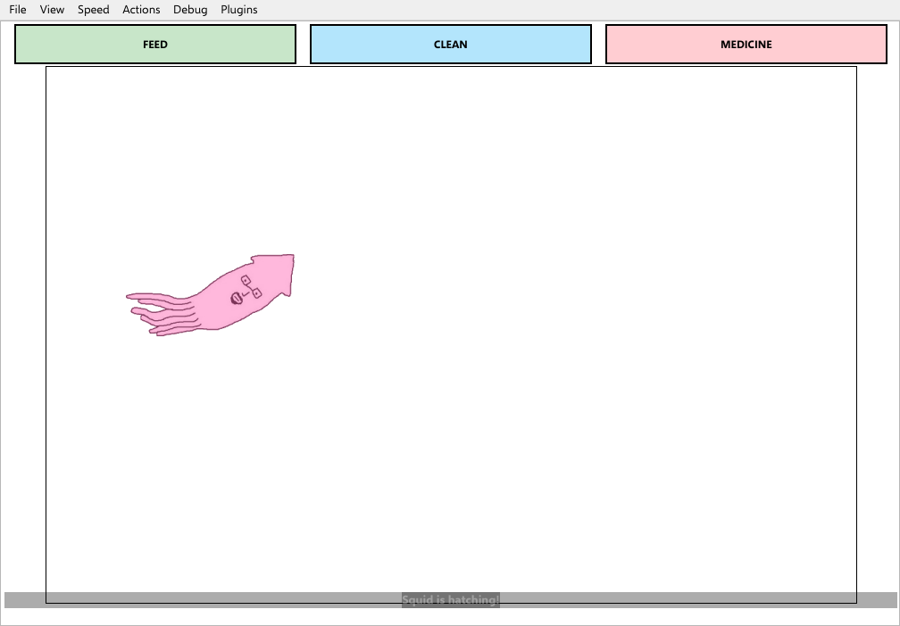 | 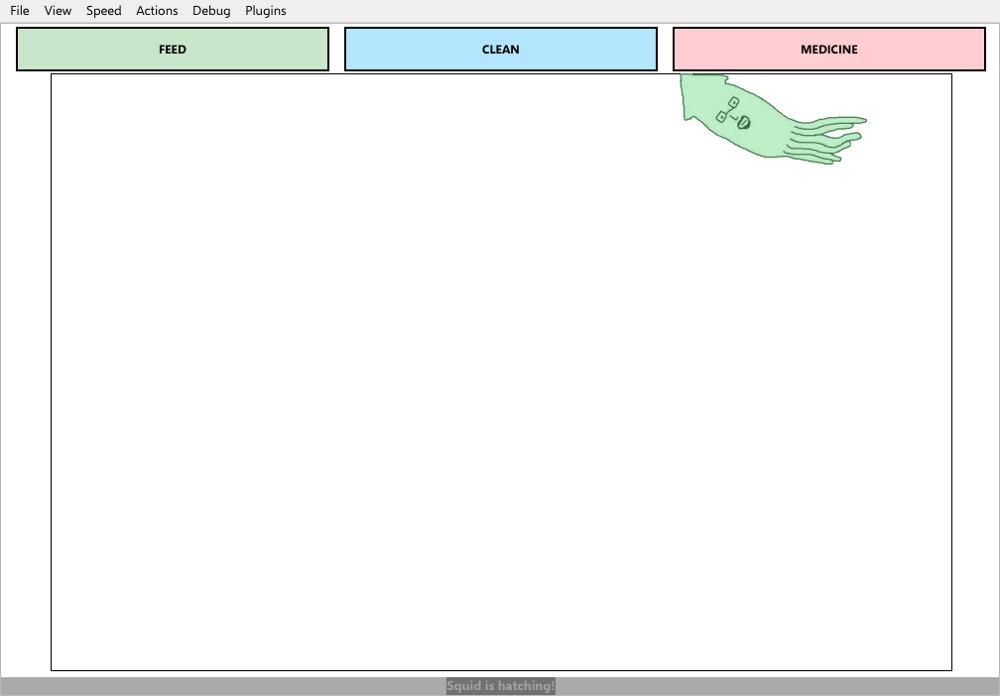 |
|---|---|---|---|

## Who went where

| When | Who | What |
|---|---|---|
| 0:04 | Ziggy | swam out of its own tank, to Pesto's |
| 0:05 | Bolt | swam out of its own tank, to Pesto's |
| 1:30 | Pesto | swam out of its own tank, to Inky's |
| 1:32 | Pesto | came home |
| 4:06 | Pesto | swam out of its own tank, to Ziggy's |
| 4:07 | Pesto | came home |
| 5:44 | Ziggy | came home |
| 5:44 | Bolt | came home |
| 5:45 | Bolt | swam out of its own tank, to Ziggy's |
| 5:56 | Ziggy | swam out of its own tank, to Inky's |

| 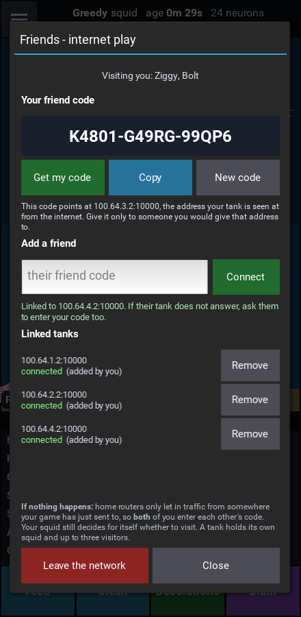 | 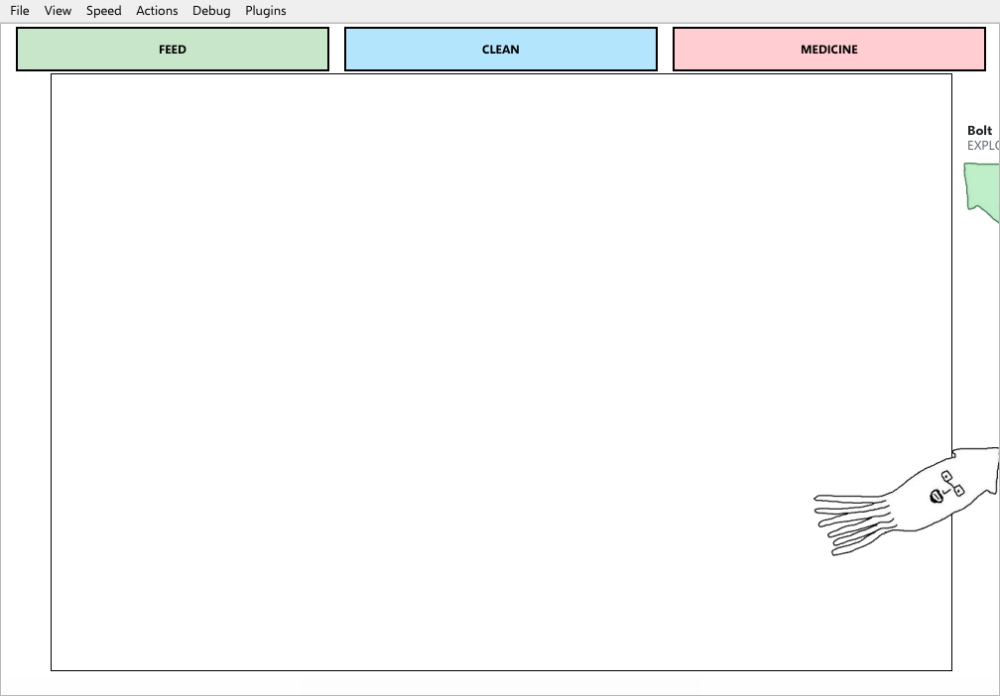 | 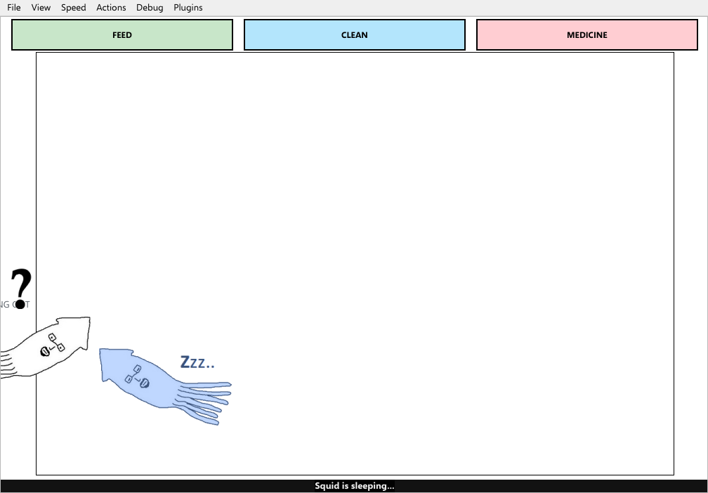 |
|---|---|---|

## What they grew

- **Ziggy**: `aquarium_nearby`, `can_see_squid`, `squid_nearby`, `social_play`, `aggression`
- **Inky**: `aquarium_nearby`, `can_see_squid`, `squid_nearby`, `social_flee`, `social_fight`, `recognises_squid`, `remembers_bad_encounter`
- **Pesto**: `external_stimulus`, `can_see_squid`, `social_flee`, `aquarium_nearby`, `squid_nearby`, `aquarium_nearby`
- **Bolt**: `aquarium_nearby`, `can_see_squid`, `social_play`, `squid_nearby`

## What they came to believe

- 0:11 Ziggy has come to believe: exploring makes squid go out of sight
- 0:33 Bolt has come to believe: exploring makes squid go out of sight
- 6:08 Inky has come to believe: fleeing makes squid go out of sight
- 6:13 Inky has come to believe: fleeing makes squid keep away
- 9:10 Inky has come to believe: fleeing brings a squid I know
- 0:40 Ziggy changed its mind: exploring makes squid go out of sight
- 0:49 Bolt changed its mind: exploring makes squid go out of sight
- 6:21 Inky changed its mind: fleeing makes squid keep away
- 6:36 Inky changed its mind: fleeing makes squid go out of sight
- 9:18 Inky changed its mind: fleeing brings a squid I know
- 9:41 Inky changed its mind: fleeing brings a squid I know

## Fights

- 7:05 Inky: Inky: Lost a fight when it was attacked: ability 126 against 146, so it had a 43% chance.
- 8:38 Inky: Inky: Won a fight when it was attacked: ability 113 against 147, so it had a 37% chance.

| 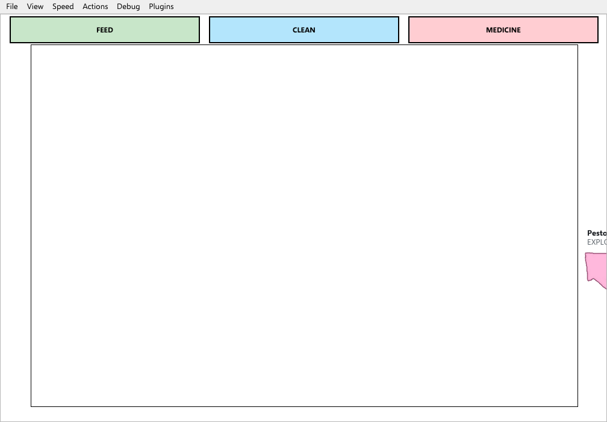 | 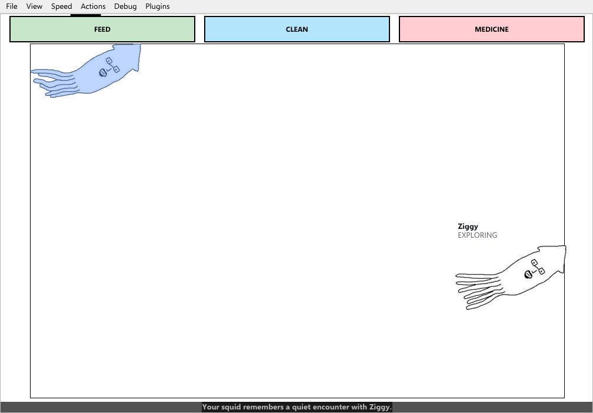 | 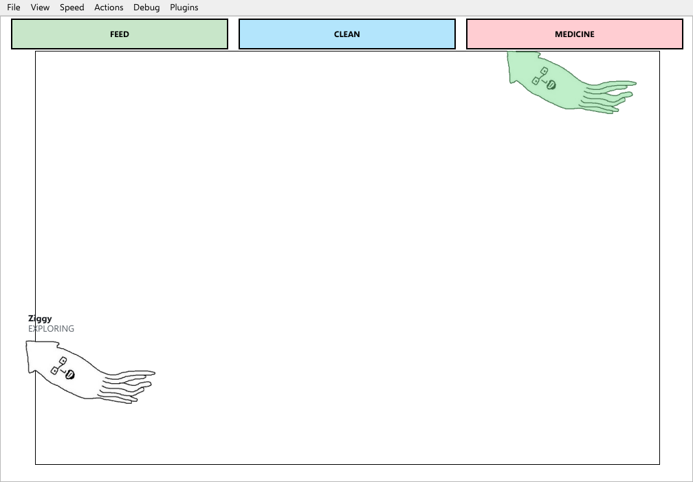 | 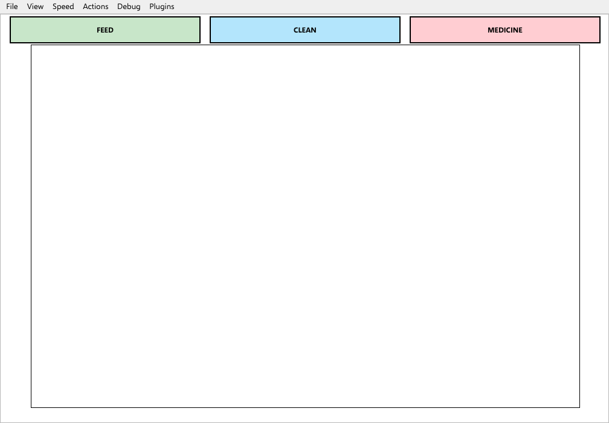 |
|---|---|---|---|

---

Made by `tools/internet_session.py` (the session) and `docs/story-gallery/source/build.py` (this page and index.html). Nothing was nudged: only each squid’s name, personality and colour were chosen. The “internet” is a private one made on one machine out of network namespaces - real address translation, not real home routers.
