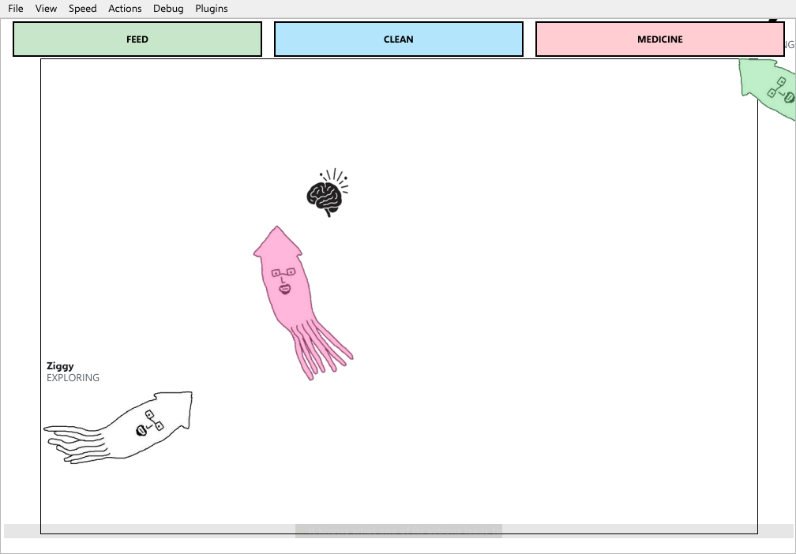
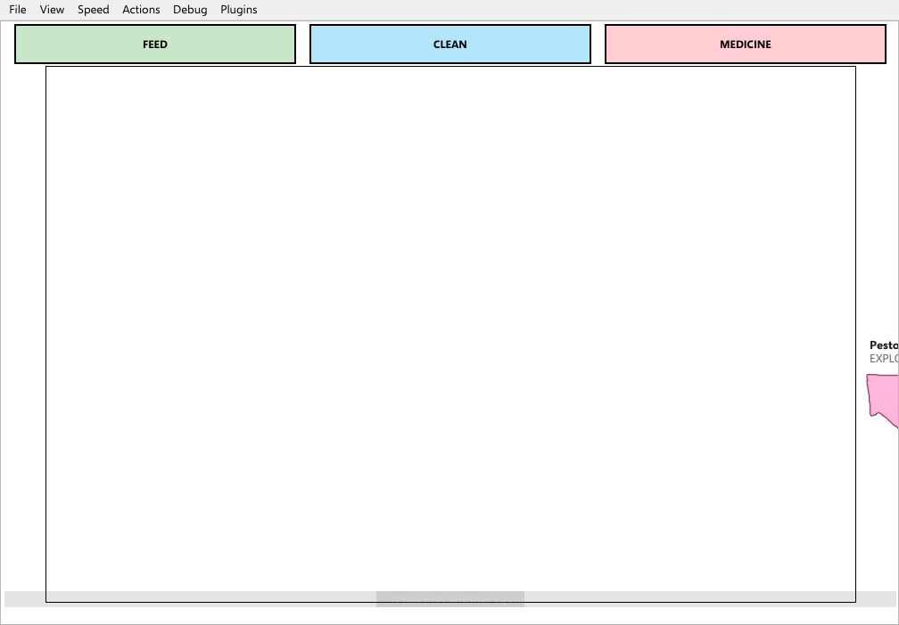
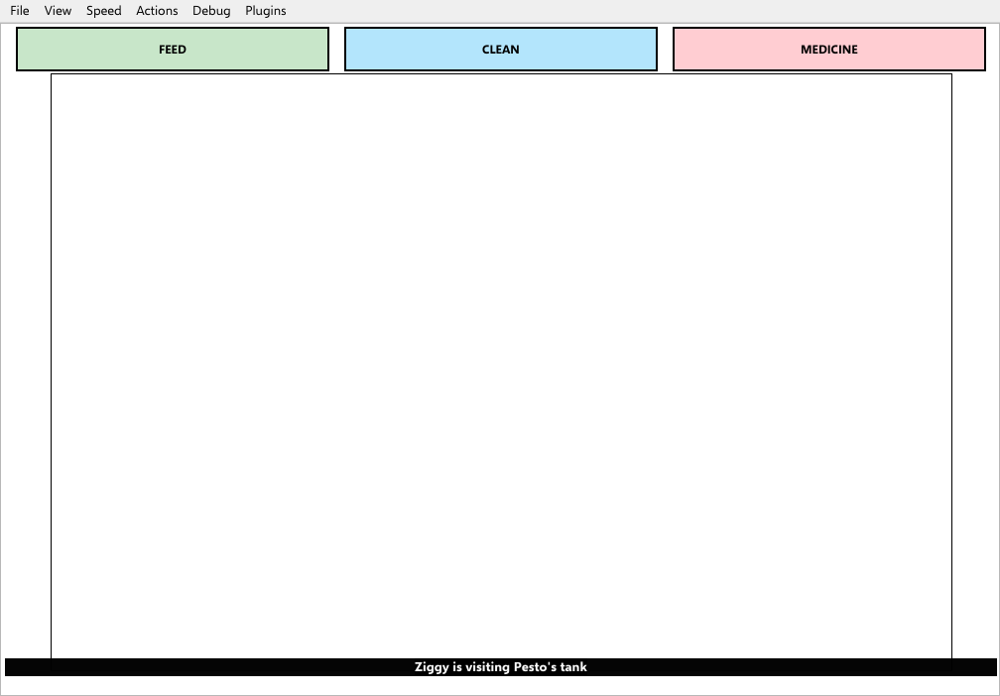

# 4 squid, 4 homes, 5 minutes

4 copies of the desktop game, each in a home of its own behind its own router, found each other with friend codes and were then left alone for 5 minutes. Nothing told any squid what to do. Every address, code, thought and number here is from the run.

**The full page, with every picture and the whole session line by line, is [index.html](index.html)** (open it in a browser).

| Squid | Personality | Colour | Home address | Seen from outside as | Friend code |
|---|---|---|---|---|---|
| Ziggy | adventurous | as it hatched | `192.168.1.2:10000` | `100.64.1.2:10000` | `K4800-G49RG-3S817` |
| Inky | timid | rgb(120,170,255) | `192.168.1.2:10000` | `100.64.2.2:10000` | `K4801-049RG-NB28H` |
| Pesto | greedy | rgb(255,105,180) | `192.168.1.2:10000` | `100.64.3.2:10000` | `K4801-G49RG-3V0CG` |
| Bolt | energetic | rgb(120,220,140) | `192.168.1.2:10000` | `100.64.4.2:10000` | `K4802-049RG-868SK` |

## Apart, then linked

Before any code was entered the tanks had heard 0 other tanks between them. Everyone entered everyone else’s code; the last of the 12 links through the routers came up 1 s later.

|  |  |  |  |
|---|---|---|---|

## Who went where

| When | Who | What |
|---|---|---|
| 0:02 | Ziggy | swam out of its own tank, to Pesto's |
| 0:04 | Bolt | swam out of its own tank, to Pesto's |
| 0:14 | Pesto | swam out of its own tank, to Ziggy's |

|  |  |  |
|---|---|---|

## What they grew

- **Ziggy**: `aquarium_nearby`, `can_see_squid`, `squid_nearby`
- **Inky**: `aquarium_nearby`
- **Pesto**: `can_see_squid`, `squid_nearby`, `aquarium_nearby`, `social_play`
- **Bolt**: `aquarium_nearby`, `can_see_squid`, `social_play`

## What they came to believe

- 0:11 Ziggy has come to believe: exploring makes squid go out of sight
- 0:19 Bolt has come to believe: exploring makes squid go out of sight
- 0:41 Ziggy changed its mind: exploring makes squid go out of sight
- 0:49 Bolt changed its mind: exploring makes squid go out of sight

## Fights

Nobody fought in this session.

|  |  |  |  |
|---|---|---|---|

---

Made by `tools/internet_session.py` (the session) and `docs/story-gallery/source/build.py` (this page and index.html). Nothing was nudged: only each squid’s name, personality and colour were chosen. The “internet” is a private one made on one machine out of network namespaces - real address translation, not real home routers.
