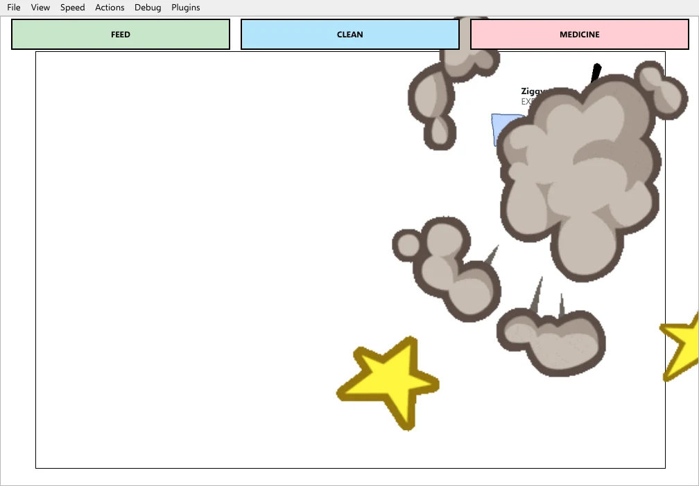
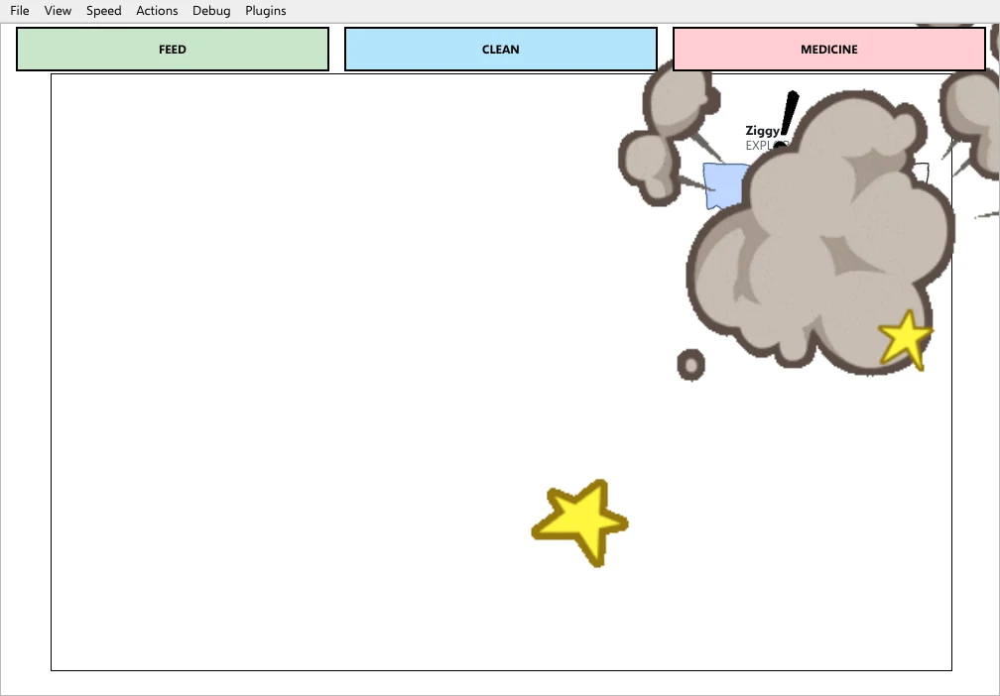
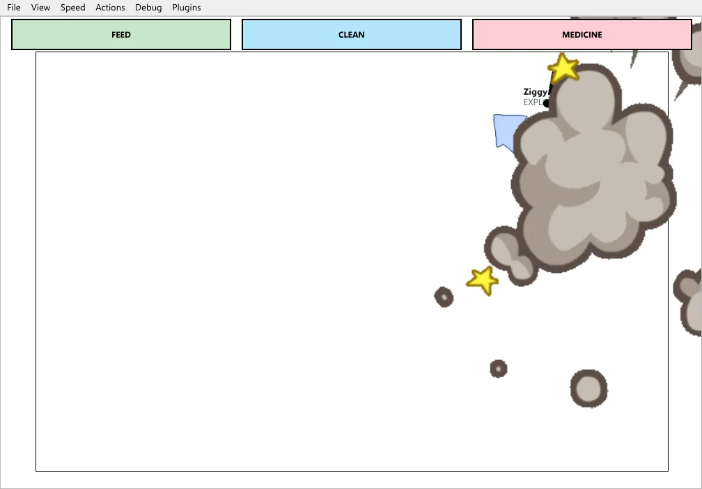

# A fight, as the two squid recorded it

Two tanks in two homes, linked by friend code and left alone. **Ziggy**
(adventurous) and **Inky** (timid, blue) were both new hatchlings. Nothing was
nudged: nobody fed them, moved them or set any value. Eight minutes in, Ziggy
went for Inky in Inky's tank. Every number and quotation below is from the two
squids' own records of that session.

|  |  |  |
|---|---|---|
| 0.9 s into the fight | 1.7 s | 2.5 s |

Inky's tank, with the cloud over the two of them. Inky is the blue squid at
its left edge; Ziggy's name is above the cloud.

## What led up to it

| When | Who | What happened |
|---|---|---|
| 0:10 | Ziggy | Swam out of its own tank and into Inky's, ten seconds after the tanks were linked. |
| 0:11 | both | Each grew `can_see_squid`: "Other squid encountered!" |
| 0:15 | Ziggy | Grew `social_play`: "It played with another squid and had no neuron for that." Ziggy's way of meeting a squid is to go up to it. |
| 2:02 | Inky | Grew `social_flee`: "It fled from another squid and had no neuron for that." Inky's way is to get away. |
| 3:10 | Inky | Filed the visit so far as a **bad encounter with Ziggy** (felt -12.2), and thought: "I am warier of squid, even ones I do not know - and of other aquariums." |
| 3:18 | Inky | Grew `recognises_squid` and `remembers_bad_encounter`: it now knew Ziggy on sight, and knew it as trouble. |
| 7:20 to 8:00 | both | Ziggy kept exploring Inky's tank while its anxiety climbed from 56 to 61. Inky was already at anxiety 100 and fleeing the whole time. |
| 8:00 | Ziggy | Grew `aggression`: "I went at another squid and had no neuron for that, so I grew aggression: the concept of 'attacking another squid'." |

## What started the fight

Ziggy did. Its record: **"I went for Inky: my aggression was 100, past the 50
it takes to start a fight."**

The aggression neuron was four seconds old. It grew because Ziggy approached
another squid, as it had been doing all visit, *while its own anxiety was
high*. Approaching while calm is play; approaching while anxious is what the
game treats as going at another squid. Once grown, the neuron went straight
to 100, and a squid goes for the other one when it passes 50.

Nothing Inky did provoked it. No food or rock was being contested: the
record's "why" holds only Ziggy's aggression. Inky's record of the same
moment: **"Ziggy came at me. I fought back with my anxiety at 100."**

## Why Ziggy lost

A fight is decided by each side's ability, with some luck. Ability comes from
the body's condition, experience, and how hard the squid's network commits.

| | Ziggy (attacker) | Inky (defender) |
|---|---|---|
| Body condition (fitness) | 0.66 | 0.70 |
| Experience | none recorded | 1.0 |
| Commitment | 100, from aggression | 100, from anxiety |
| **Ability** | **99** | **105** |
| Chance of winning | 47% | 53% |

Both committed completely, Ziggy out of aggression and Inky out of fear, so
commitment decided nothing. The difference was the body: Ziggy was slightly
hungrier (58 against 54) and slightly more tired (79 against 77) after eight
minutes of exploring. That made it close to a coin toss tilted Inky's way,
and it fell Inky's way.

Thirty-four seconds later Ziggy went for Inky again, still at aggression 100.
Hurt from the first fight, its ability was down to 90 against Inky's 106, a
42% chance. It lost again.

## What it cost

| | Ziggy (lost twice) | Inky (won twice) |
|---|---|---|
| Health, per fight | -8 | -3 |
| Happiness | -10 | 0 |
| Anxiety | +15 | -5 |
| Satisfaction | -5 | 0 |

## What each remembers

**Ziggy**, of the first fight: "Lost a fight it started (aggression 100):
ability 99 against 105, so it had a 47% chance." Of the second: "Lost a fight
it started (aggression 100): ability 90 against 106, so it had a 42% chance."
When it finally went home at 11:24 it filed the whole visit as a **beaten
encounter with Inky**, the worst memory in the session (felt -84.8, fights
lost 2). It now "remembers it badly".

**Inky**, of the first fight: "Won a fight when it was attacked: ability 105
against 99, so it had a 53% chance." Of the second: "Won a fight when it was
attacked: ability 106 against 90, so it had a 58% chance." Winning did not
make the visit a good one: Inky's memory of Ziggy is still a bad encounter.

## What each took from it

**Ziggy**

- "Something has changed in me: my aggression rests at 4 now, not 0, and
  always will - I lost a fight with Inky." After the second: 8, not 4. Losing
  raises a squid's resting aggression more than winning does, and it never
  goes back down.
- Its feeling about squid in general moved towards wariness (-0.75 learned
  from encounters), though it is still "drawn to other squid".
- It went back. Three seconds after getting home it left for Inky's tank
  again, and at 12:28 grew `recognises_squid` for Inky.

**Inky**

- It grew no aggression. It never started anything; both times it fought
  because it was attacked, with its anxiety at 100.
- It ended "afraid of other squid" (-0.80 learned from encounters).

## What they came to believe

A squid notices what follows what it does and takes that for how its world
works. These are the beliefs each formed about the other during the session,
and which it later gave up when experience did not bear them out.

| When | Who | Belief | Kept? |
|---|---|---|---|
| 0:18 | Ziggy | exploring makes squid go out of sight | given up at 0:25 |
| 0:32 | Inky | exploring makes squid go out of sight | given up at 0:57 |
| 1:02 | Inky | roaming makes squid go out of sight | kept |
| 2:00 | Inky | fleeing makes squid go out of sight | given up at 2:20 |
| 2:02 | Inky | inking brings squid into sight | kept |
| 3:25 | Inky | fleeing makes a squid I know go away | given up at 3:56 |
| 11:31 | Ziggy | sleeping brings squid into sight | kept |
| 12:35 | Ziggy | exploring makes a squid I know go away | given up at 13:05 |

Inky twice came to believe that fleeing gets rid of the other squid, and
twice found it did not: Ziggy kept coming.

## A fault this fight exposed, since fixed

Inky's record of Ziggy counted no fights won, although Inky's own fight
memories record both wins; and the same "bad encounter with Ziggy" appeared
three times (3:10, 6:11, 9:11), each marked as their first meeting.

Both had one cause. A host's encounter with a visitor that stays is closed
and begun again every three minutes, and each was filed under the same
memory key. The memory store keeps the first value written under a key, so
everything after the first three minutes was dropped - the fights included -
and the first memory, its time refreshed, looked as if it had been filed
again. A later encounter with a squid already remembered is now its own
memory, and counts.

---

Recorded by `tools/internet_session.py` (two homes, each behind its own
simulated router). The session was stopped at about fourteen minutes.
